<!-- ──────────────────────────────────────────────────────────────── -->
<!--  Fuad Ahamed · GitHub Profile README                             -->
<!--  Repo: FuadAhamed91/FuadAhamed91                                 -->
<!-- ──────────────────────────────────────────────────────────────── -->

<div align="center">



<h3>I build digital twins, AI products and games — and ship them fast enough to win hackathons.</h3>

<p>3D digital twins · AI-powered health & commerce · Unity games · security tooling · agent-to-agent services</p>


<br/><br/>

<a href="https://github.com/FuadAhamed91"></a>
<a href="mailto:fuadoow@gmail.com"></a>
<!-- LinkedIn badge — uncomment and set your URL
<a href="https://www.linkedin.com/in/YOUR-HANDLE/"></a>
-->

<br/><br/>


<a href="https://github.com/FuadAhamed91?tab=followers"></a>


<br/><br/>


</div>

<br/>


## 🧭 About Me

I'm a builder from the UAE who likes the whole stack: the 3D scene, the AI behind it, the backend that keeps it honest, and the pitch that sells it.

- 🏆 **2× 1st place** — **AI Everything Hackathon** with *UnderGrid*, and **Oriane × Replit Build for the Video Economy** (1st of 48 teams) with *PRE//FLIGHT*.
- 🌐 **Digital twins are my thing** — an underground-utility twin of a city, a drone network-mobility twin, interactive 3D venues for Sharjah tourism.
- 🏥 **AI that has to be safe** — co-built **CareLoop**, WhatsApp post-discharge follow-up for UAE hospitals with AI triage and nurse escalation.
- 🎮 **Game dev on the side** — Unity 6 physics puzzles and a murder mystery, with every 3D asset generated from Blender scripts.
- 🛡️ **Security minded** — a phishing-link Chrome extension, a SOC detection-engineering lab, and a runtime firewall for IntelliJ plugins.


## 🏆 Hackathon Wins

<div align="center">



</div>

| Result | Event | Build | What it does |
|---|---|---|---|
| 🥇 **1st Place** | **AI Everything Hackathon** | **[UnderGrid](https://github.com/bilal-feroz/qoder-hackathon)** | A live 3D digital twin of a city's underground water, sewage, power and cooling network. It links weak sensor signals (a 2.7% pressure drop, wetter soil, warmer ground), pinpoints the failing pipe and the spot on it, forecasts the failure window, weighs who'd be affected, and hands crews a repair plan. Demo scenario: an ~AED 660K planned repair avoids ~AED 5.94M of damage. |
| 🥇 **1st Place** (of 48 teams) | **Build for the Video Economy** — Oriane × Replit, Dubai | **PRE//FLIGHT** | Tells brands whether their campaign idea has already been done, *before* they spend money shooting it. Paste a brief: it searches real Instagram and TikTok videos through Oriane, shows how crowded the idea is and whether it's early or late, then points to where there's still room. [Demo video →](https://www.youtube.com/watch?v=g_B3rjgLcC4) |

**Other competition builds**

| Event | Build | |
|---|---|---|
| 🎮 **Cambridge × Arcade AI Hackathon** — Game Tech Track | **[Materialize](https://github.com/FuadAhamed91/Materialize)** | Type any object, an LLM compiles its real-world physics, and it materializes · [play](https://materialize-eight.vercel.app) |
| 📡 **ATRC Advanced Technology Pioneers 2026** — EDGE Challenge | **[FlexiPath](https://github.com/FuadAhamed91/FlexiPath)** | Predictive, traffic-aware connectivity across Wi-Fi / 5G / LEO / wired, shown on a Three.js drone digital twin |
| 🏜️ **Sharjah Tourism Innovation Hackathon** | **[Fadhal](https://github.com/Mohammad-Umar7/LOCALDAYS)** | Book Sharjah's living traditions, step inside each venue in 3D · [live](https://localdays.vercel.app) |
| 🔗 **XDC AI Marketplace** (x402) | **[AgentSentinel](https://github.com/FuadAhamed91/agentsentinel)** | A paid API that AI agents buy from: on-chain merchant leaderboard + price/gas/wallet watches, settled in USDC |
| 🛡️ Team hackathon build | **[PluginFence](https://github.com/bilal-feroz/PluginFence)** | Runtime firewall for IntelliJ plugins: watches what they actually do and blocks the dangerous parts |


## 🚢 Flagship Projects

### 🌆 UnderGrid — Underground Infrastructure Digital Twin · 🥇 AI Everything Hackathon

<a href="https://github.com/bilal-feroz/qoder-hackathon"></a>


> Cities usually find out a pipe is failing *after* it bursts. UnderGrid finds it days earlier, and shows you exactly where.

- **Flow →** DETECT a subsurface anomaly (93% confidence) → PREDICT the failure horizon (36–52 h) → PRIORITIZE by hospitals, schools and traffic nearby → PLAN the crew, detours, parts and dig schedule.
- **The twin →** the city turns see-through, the faulty pipe glows, the leak point is marked, and affected buildings light up. I built the **+48H view** that shows the burst if nobody acts.
- ⚙️ `TypeScript` `Three.js` `3D digital twin` `sensor simulation`

### 🏥 CareLoop — Post-Discharge Patient Follow-Up on WhatsApp

<a href="https://github.com/FuadAhamed91/-DischargeIQ"></a>
<a href="https://discharge-iq.vercel.app"></a>
<a href="https://github.com/Mohammad-Umar7/CareLoop"></a>

> Patients never install anything: their care plan, a check-in every night, and answers on WhatsApp in their own language, with a nurse alerted the moment a warning sign appears.

- **Flow →** a nurse drops the discharge PDF, Gemini reads it into a care plan the nurse approves, and the patient gets it on WhatsApp. Questions are answered strictly from their own discharge instructions.
- **Safety →** symptom reports and voice notes are triaged against the patient's own warning signs; emergencies escalate instantly, even if the model is down.
- **Engineering →** multi-tenant Supabase with Row Level Security, Vercel Cron + `pg_cron` scheduling, six staff roles. ~90 of the commits are mine.
- ⚙️ `Next.js 16` `React 19` `TypeScript` `Supabase` `Twilio WhatsApp` `Gemini 2.5 Flash` `Vercel`

### 📡 FlexiPath — Predictive Connectivity Engine · ATRC EDGE Challenge 2026

<a href="https://github.com/FuadAhamed91/FlexiPath"></a>

> **Don't wait for failure.** FlexiPath predicts when the current network path is degrading, prepares the next one before it's needed, and switches without breaking sessions.

- **Scenario →** two identical drones fly the same corridor (dock → Wi-Fi → 5G → LEO satellite); one runs FlexiPath, the other a legacy break-before-make stack, under the same seeded radio field.
- **Rigor →** compared against MPTCP / 3GPP ATSSS baselines, with ablations, prediction precision & recall, a held-out seed block, and negative results reported too.
- **Twin →** Three.js night city + explainable decision HUD (*"Why did FlexiPath do that?"*), all 3D assets generated by a Blender pipeline.
- ⚙️ `JavaScript` `Three.js` `Blender Python` `network simulation`

### 🧪 Materialize — LLM-Compiled Physics Puzzle Game

<a href="https://github.com/FuadAhamed91/Materialize"></a>
<a href="https://materialize-eight.vercel.app"></a>

> Type any object, an LLM compiles its real-world physics (mass, restitution, friction, density, conductivity), and it materializes as a real rigidbody.

- Ten physics chambers — counterweights, buoyancy, momentum, insulation, friction — every solution verified by automated Play-mode tests.
- The whole level is generated: Blender script → FBX → Unity scene builder → scene validator.
- ⚙️ `Unity 6 URP` `C#` `LLM` `Blender Python` `WebGL on Vercel`

### 🔗 AgentSentinel — A Service Sold *to* AI Agents

<a href="https://github.com/FuadAhamed91/agentsentinel"></a>

> Listed on the XDC AI marketplace: agents pay per call in USDC (x402) for an on-chain merchant leaderboard, plus price, gas and wallet watches that remember moves between checks.

- ⚙️ `Node.js` `XDC` `x402` `USDC` `SQLite` `Replit`


## 🗂️ Everything I've Built or Contributed To

**🌐 Digital Twins & 3D**
- [`bilal-feroz/qoder-hackathon`](https://github.com/bilal-feroz/qoder-hackathon) → **UnderGrid** — 🥇 AI Everything Hackathon · underground infrastructure twin
- [`FlexiPath`](https://github.com/FuadAhamed91/FlexiPath) → zero-disruption network mobility twin (Wi-Fi / 5G / LEO / wired)
- [`Mohammad-Umar7/LOCALDAYS`](https://github.com/Mohammad-Umar7/LOCALDAYS) → **Fadhal** — Sharjah living traditions in interactive 3D · [live](https://localdays.vercel.app) · *I built the 3D-first venue pages and scrollable hotspot chips*

**🤖 AI Products**
- **PRE//FLIGHT** → 🥇 Oriane × Replit · campaign-idea saturation check over real IG/TikTok video · [demo](https://www.youtube.com/watch?v=g_B3rjgLcC4)
- [`-DischargeIQ`](https://github.com/FuadAhamed91/-DischargeIQ) / [`Mohammad-Umar7/CareLoop`](https://github.com/Mohammad-Umar7/CareLoop) → **CareLoop** — WhatsApp patient follow-up with AI triage · [live](https://discharge-iq.vercel.app)
- [`agentsentinel`](https://github.com/FuadAhamed91/agentsentinel) → paid agent-to-agent API on the XDC AI marketplace

**🎮 Games**
- [`Materialize`](https://github.com/FuadAhamed91/Materialize) → type an object, an LLM gives it physics · [play](https://materialize-eight.vercel.app)
- [`MysterySolver`](https://github.com/FuadAhamed91/MysterySolver) → **The Spooky Crime Scene** — three-case first-person murder mystery, procedurally synthesised horror audio · [play](https://the-spooky-crime-scene.vercel.app)

**🛡️ Security**
- [`phishing-detector-extension`](https://github.com/FuadAhamed91/phishing-detector-extension) → MV3 extension: hover a link, get a 1–100 safety score and the reasons (look-alikes, punycode, `@` tricks, redirect unwrapping)
- [`cloud-soc-lab`](https://github.com/FuadAhamed91/cloud-soc-lab) → detection-engineering lab: Wazuh + Sysmon + Atomic Red Team, Sigma rules mapped to MITRE ATT&CK
- [`bilal-feroz/PluginFence`](https://github.com/bilal-feroz/PluginFence) → runtime firewall for IntelliJ plugins · *I made the hackathon pitch deck*

**📱 Web & Mobile**
- [`elite-motors-workshop`](https://github.com/FuadAhamed91/elite-motors-workshop) → client landing page for an Abu Dhabi auto workshop, live open/closed status in Dubai time · [live](https://elite-motors-workshop.vercel.app)
- [`Mohammad-Umar7/fitness-app`](https://github.com/Mohammad-Umar7/fitness-app) → **Pulse** — Flutter fitness app: strength, cardio & nutrition with Supabase

## 🌳 Project Map

```text
FuadAhamed91 · Projects I built or committed to
│
├── 🏆 Wins
│   ├── UnderGrid            → 🥇 AI Everything Hackathon
│   └── PRE//FLIGHT          → 🥇 Oriane × Replit (1st of 48)
│
├── 🌐 Digital Twins & 3D
│   ├── FlexiPath            → drone network-mobility twin · ATRC EDGE
│   └── Fadhal (LOCALDAYS)   → Sharjah traditions in 3D · live
│
├── 🤖 AI Products
│   ├── CareLoop / DischargeIQ → WhatsApp patient follow-up · live
│   └── agentsentinel        → API sold to AI agents (x402)
│
├── 🎮 Games
│   ├── Materialize          → LLM-compiled physics puzzles · playable
│   └── MysterySolver        → The Spooky Crime Scene · playable
│
├── 🛡️ Security
│   ├── phishing-detector-extension
│   ├── cloud-soc-lab
│   └── PluginFence          → IntelliJ plugin firewall
│
└── 📱 Web & Mobile
    ├── elite-motors-workshop → client site · live
    └── fitness-app           → Pulse (Flutter)
```


## 🧰 Tech Toolbox

<div align="center">

**Languages**


**Frontend, 3D & Games**


**Backend, Data & Cloud**


<br/><br/>


</div>


## 📊 GitHub Signals

<div align="center">


<br/><br/>


<br/><br/>


<br/><br/>

<picture>
  <source media="(prefers-color-scheme: dark)" srcset="https://raw.githubusercontent.com/FuadAhamed91/FuadAhamed91/output/github-contribution-grid-snake-dark.svg" />
  <source media="(prefers-color-scheme: light)" srcset="https://raw.githubusercontent.com/FuadAhamed91/FuadAhamed91/output/github-contribution-grid-snake.svg" />
  
</picture>

</div>


## 🤝 Let's Build Something

Open to **hackathon teammates**, **internships**, and anyone building digital twins, AI products, or games that need to actually ship.

<div align="center">

<a href="mailto:fuadoow@gmail.com"></a>
<a href="https://github.com/FuadAhamed91"></a>

<br/><br/>


</div>
