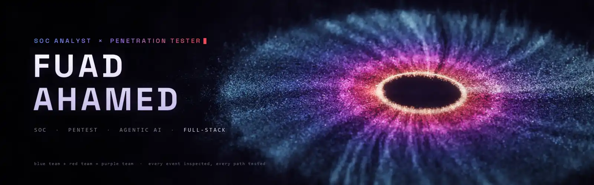
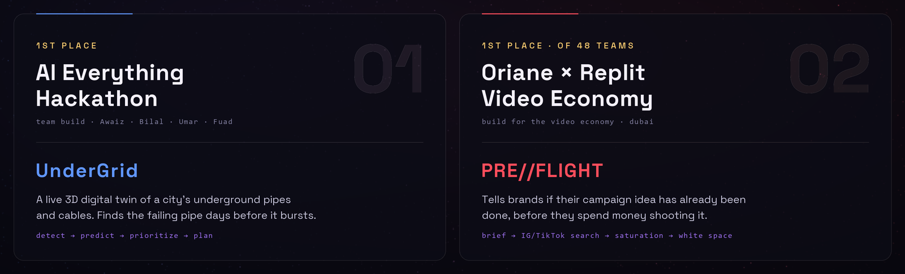

<!-- ──────────────────────────────────────────────────────────────── -->
<!--  Fuad Ahamed · GitHub Profile README                             -->
<!--  Banner source + build script: assets/render/                    -->
<!-- ──────────────────────────────────────────────────────────────── -->

<div align="center">

<!-- Banner: a rendered particle iris (~400k emitters, depth of field, motion blur, bloom). Source in assets/render/ -->
<picture>
  
</picture>

<h3>Security engineer who builds: blue-team detection, red-team testing, and the AI and full-stack skills to ship my own tools.</h3>

<p>SOC & detection engineering · penetration testing · agentic AI · full-stack · 3D digital twins</p>


<br/><br/>

<a href="https://github.com/FuadAhamed91"></a>
<a href="mailto:fuadoow@gmail.com"></a>
<!-- LinkedIn badge: uncomment and set your URL
<a href="https://www.linkedin.com/in/YOUR-HANDLE/"></a>
-->

<br/><br/>


<a href="https://github.com/FuadAhamed91?tab=followers"></a>


<br/><br/>


</div>

<br/>


## 🛡️ Security First

I work both sides of the wire. On the **blue team** I build detections and prove they fire. On the **red team** I find the way in before someone else does. And because I'm also a developer, I build the tools, dashboards and agents I need to do both.

| 🔵 Blue team · SOC & detection | 🔴 Red team · penetration testing | 🟣 Agentic AI & security tooling |
|---|---|---|
| Endpoint telemetry with **Wazuh + Sysmon**. Techniques detonated with **Atomic Red Team**. Rules written in **Sigma** first, then as SIEM-native rules, with coverage measured against **MITRE ATT&CK**. | Recon and enumeration (**Nmap**), web-app testing against the **OWASP Top 10** (**Burp Suite**), exploitation and post-exploitation in authorised labs (**Metasploit**), packet analysis (**Wireshark**), and reports that explain the fix. | Agents that watch and pay: **AgentSentinel** sells monitoring to AI agents over **x402**. Security tools I wrote myself: a phishing-link scorer and a runtime firewall for IDE plugins. LLM features built to **fail safe**. |

**How I write a detection** (from [`cloud-soc-lab`](https://github.com/FuadAhamed91/cloud-soc-lab)):

```text
 detonate ──▶ collect ──▶ analyse ──▶ write rule ──▶ re-detonate ──▶ record
 Atomic Red   Sysmon →    decide the   Sigma first,   must fire, and   ATT&CK coverage
 Team         Wazuh       logic        then Wazuh     must NOT fire    matrix updated
                                                      on benign noise
```

### 🔐 Security Projects

**🧪 [cloud-soc-lab](https://github.com/FuadAhamed91/cloud-soc-lab)**: SOC + cloud detection-engineering lab
> Built to answer the interview question *"Show me a detection you wrote, and how you know it works."* Simulate the attacker, find the gaps in default detection, write the rule, and prove it.
- Endpoint lab: **Wazuh + Sysmon + Atomic Red Team**, with custom rules mapped to ATT&CK and a test record for every technique.
- Next: cloud detection (**CloudTrail / GuardDuty → SIEM**, Stratus Red Team, **Terraform**, Prowler) and serverless phishing triage.
- ⚙️ `Wazuh` `Sysmon` `Sigma` `Atomic Red Team` `MITRE ATT&CK` `Vagrant` `Terraform`

**🎣 [phishing-detector-extension](https://github.com/FuadAhamed91/phishing-detector-extension)**: hover a link, see where it *really* goes
> A Chrome (MV3) extension that gives every link a 1–100 safety score, with the reasons. No network calls, no data collection.
- Unwraps Google, Microsoft Safe Links, Proofpoint and Barracuda redirectors, then scores the real destination.
- Catches look-alike domains (`amaz0n`, `rnicrosoft`, Cyrillic punycode), the `user@host` trick, raw IPs, abused TLDs and brand names on domains the brand doesn't own. ~80 impersonated brands covered.
- ⚙️ `JavaScript` `Chrome MV3` `public-suffix parsing` `homograph detection`

**🧱 [PluginFence](https://github.com/bilal-feroz/PluginFence)**: a runtime firewall for IntelliJ plugins *(team build)*
> IDE plugins run with full access to your SSH keys, `.env` files and cloud credentials. PluginFence watches what a plugin *actually* tries to do, then allows it, blocks it or raises an alert, and flags behaviour that changes after an update.
- ⚙️ `Kotlin` `JVM agent (java.lang.instrument)` `policy engine` · I built the hackathon pitch deck.

**🔗 [AgentSentinel](https://github.com/FuadAhamed91/agentsentinel)**: monitoring sold *to* AI agents
> Live on the XDC AI marketplace. Agents pay per call in USDC (x402) for an on-chain merchant leaderboard and for price, gas and wallet watches that catch the moves that happen between two checks.
- ⚙️ `Node.js` `XDC` `x402` `USDC` `SQLite` `Replit`

### 🧰 Security Toolbox

<div align="center">

**Blue team**


**Red team**


**Scripting & infrastructure**


</div>


## 🏆 Hackathon Wins

<div align="center">



</div>

| Result | Event | Build | What it does |
|---|---|---|---|
| 🥇 **1st Place** | **AI Everything Hackathon** | **[UnderGrid](https://github.com/bilal-feroz/qoder-hackathon)** | A live 3D digital twin of a city's underground water, sewage, power and cooling network. It connects weak sensor signals (a 2.7% pressure drop, wetter soil, warmer ground), pinpoints the failing pipe and the spot on it, forecasts the failure window, and hands crews a repair plan. In the demo scenario, an ~AED 660K planned repair avoids ~AED 5.94M of damage. |
| 🥇 **1st Place** (of 48 teams) | **Build for the Video Economy** (Oriane × Replit, Dubai) | **PRE//FLIGHT** | Tells brands whether their campaign idea has already been done, *before* they spend money shooting it. It searches real Instagram and TikTok videos through Oriane, shows how crowded the idea is, and points to where there's still room. [Demo video →](https://www.youtube.com/watch?v=g_B3rjgLcC4) |

**Other competition builds**

| Event | Build | |
|---|---|---|
| 🎮 **Cambridge × Arcade AI Hackathon** (Game Tech Track) | **[Materialize](https://github.com/FuadAhamed91/Materialize)** | Type any object, an LLM works out its real-world physics, and it materializes · [play](https://materialize-eight.vercel.app) |
| 📡 **ATRC Advanced Technology Pioneers 2026** (EDGE Challenge) | **[FlexiPath](https://github.com/FuadAhamed91/FlexiPath)** | Predictive, traffic-aware connectivity across Wi-Fi / 5G / LEO / wired, shown on a Three.js drone digital twin |
| 🏜️ **Sharjah Tourism Innovation Hackathon** | **[Fadhal](https://github.com/Mohammad-Umar7/LOCALDAYS)** | Book Sharjah's living traditions and step inside each venue in 3D · [live](https://localdays.vercel.app) |
| 🛡️ Team hackathon build | **[PluginFence](https://github.com/bilal-feroz/PluginFence)** | Runtime firewall for IntelliJ plugins |


## 🛠️ …and I Build, Too

Security is easier when you can build what you defend. These are the products, twins and games I've shipped or committed to.

### 🌆 UnderGrid: Underground Infrastructure Digital Twin · 🥇 AI Everything

<a href="https://github.com/bilal-feroz/qoder-hackathon"></a>


- **Flow →** DETECT a subsurface anomaly → PREDICT the failure horizon (36–52 h) → PRIORITIZE by the hospitals, schools and traffic nearby → PLAN the crew, detours, parts and dig.
- **The twin →** the city turns see-through, the faulty pipe glows, and the affected buildings light up. I built the **+48H view**, which shows the burst if nobody acts.
- ⚙️ `TypeScript` `Three.js` `3D digital twin` `sensor simulation`

### 🏥 CareLoop: Post-Discharge Patient Follow-Up on WhatsApp

<a href="https://github.com/FuadAhamed91/-DischargeIQ"></a>
<a href="https://discharge-iq.vercel.app"></a>

- A nurse drops in the discharge PDF and Gemini reads it into a care plan, which the nurse approves before the patient gets it on WhatsApp. Symptom reports are triaged against the patient's own warning signs, and they still escalate when the model is down.
- **Security model →** multi-tenant Postgres with **Row Level Security** on every row, six staff roles, and secrets kept in Supabase Vault. About 90 of the commits are mine.
- ⚙️ `Next.js 16` `TypeScript` `Supabase` `Twilio WhatsApp` `Gemini 2.5 Flash` `Vercel`

### 📡 FlexiPath: Predictive Connectivity Engine · ATRC EDGE 2026

<a href="https://github.com/FuadAhamed91/FlexiPath"></a>

- Two identical drones fly the same corridor (dock → Wi-Fi → 5G → LEO satellite). One runs FlexiPath and the other a legacy stack, under the same seeded radio field. FlexiPath predicts that a path is failing and moves before the break.
- Compared against MPTCP and 3GPP ATSSS baselines, with ablations, prediction precision and recall, and held-out seeds. Negative results are reported too.
- ⚙️ `JavaScript` `Three.js` `Blender Python` `network simulation`

### 🧪 Materialize · 🔎 The Spooky Crime Scene: games

<a href="https://materialize-eight.vercel.app"></a>
<a href="https://the-spooky-crime-scene.vercel.app"></a>

- **Materialize**: type any object and an LLM compiles its physics. Ten chambers cover mass, buoyancy, momentum, insulation and friction, and every solution is verified by automated tests.
- **The Spooky Crime Scene**: a first-person murder mystery with three cases, red herrings, informants and procedurally synthesised horror audio.
- ⚙️ `Unity 6 URP` `C#` `LLM` `Blender Python` `WebGL`

## 🗂️ Everything I've Built or Contributed To

```text
FuadAhamed91 · projects I built or committed to
│
├── 🛡️ Security
│   ├── cloud-soc-lab                → SOC detection-engineering lab · ATT&CK
│   ├── phishing-detector-extension  → link safety score on hover · MV3
│   └── PluginFence                  → runtime firewall for IntelliJ plugins
│
├── 🏆 Wins
│   ├── UnderGrid                    → 🥇 AI Everything Hackathon
│   └── PRE//FLIGHT                  → 🥇 Oriane × Replit (1st of 48)
│
├── 🤖 AI & Agents
│   ├── agentsentinel                → API sold to AI agents (x402)
│   └── CareLoop / -DischargeIQ      → WhatsApp patient follow-up · live
│
├── 🌐 Digital Twins & 3D
│   ├── FlexiPath                    → drone network-mobility twin · ATRC EDGE
│   └── Fadhal (LOCALDAYS)           → Sharjah traditions in 3D · live
│
├── 🎮 Games
│   ├── Materialize                  → LLM-compiled physics puzzles · playable
│   └── MysterySolver                → The Spooky Crime Scene · playable
│
└── 📱 Web & Mobile
    ├── elite-motors-workshop        → client site for an Abu Dhabi workshop · live
    └── fitness-app                  → Pulse · Flutter + Supabase
```

### 🧰 Dev Toolbox

<div align="center">


<br/>


<br/>


<br/><br/>


</div>


## 📊 GitHub Signals

<div align="center">


<br/><br/>


</div>


## 🤝 Let's Talk

Open to **SOC and pentest roles**, **internships**, **hackathon teams**, and anyone who wants a security person who can also ship the product.

<div align="center">

<a href="mailto:fuadoow@gmail.com"></a>
<a href="https://github.com/FuadAhamed91"></a>

<br/><br/>

<sub>Banner and avatar are rendered, not drawn: <a href="assets/render">assets/render</a> holds the particle renderer.</sub>

</div>
